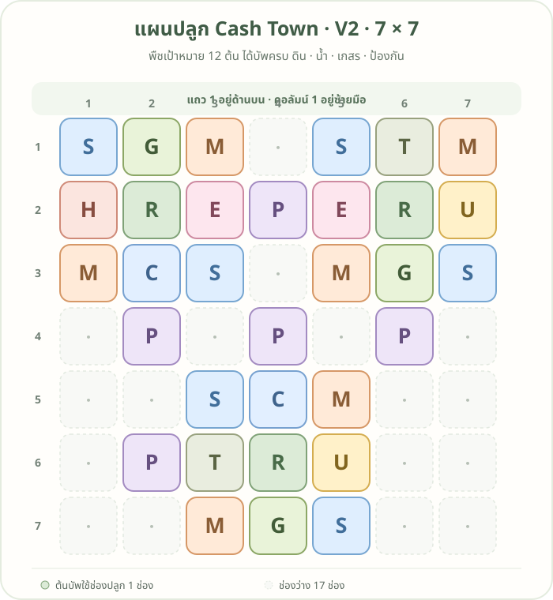

# แผนปลูก 7×7 · V2: 12 ต้น

เวอร์ชันนี้เพิ่ม **น้ำเต้าค้างอีก 1 ต้น** จาก V1 โดยไม่ต้องย้ายต้นบัพ พืชเป้าหมายทั้ง **12 ต้น** ได้แถบ **ดิน น้ำ เกสร และป้องกัน** ครบ

## อ่านรหัสในผัง

| รหัส | พืช | จำนวน |
|---|---|---:|
| G | น้ำเต้าค้าง | 3 |
| E | เบอร์รี่ค้าง | 2 |
| C | ข้าวโพดสีน้ำเงิน | 2 |
| T | ยอดชาพุ่ม | 2 |
| U | ทานตะวันสวน | 2 |
| H | กระเจี๊ยบแดงสวน | 1 |
| R | ถั่วรันเนอร์ — บัพดิน | 3 |
| S | สตรอว์เบอร์รี่สวน — บัพน้ำ | 6 |
| M | ดาวเรือง — บัพป้องกัน | 6 |
| P | โบราจ — บัพเกสร | 5 |

## พืชเป้าหมายและตำแหน่ง

พิกัดเขียนเป็น **แถว, คอลัมน์** โดยนับจากมุมซ้ายบน เริ่มที่ 1

| รหัส | พืช | จำนวน | ตำแหน่ง |
|---|---|---:|---|
| G | น้ำเต้าค้าง | 3 | (1,2), (3,6), **(7,4)** |
| E | เบอร์รี่ค้าง | 2 | (2,3), (2,5) |
| C | ข้าวโพดสีน้ำเงิน | 2 | (3,2), (5,4) |
| T | ยอดชาพุ่ม | 2 | (1,6), (6,3) |
| U | ทานตะวันสวน | 2 | (2,7), (6,5) |
| H | กระเจี๊ยบแดงสวน | 1 | (2,1) |

## ต้นบัพในผัง

| รหัส | พืชบัพ | จำนวน | ตำแหน่ง |
|---|---|---:|---|
| R | ถั่วรันเนอร์ · ดิน | 3 | (2,2), (2,6), (6,4) |
| S | สตรอว์เบอร์รี่สวน · น้ำ | 6 | (1,1), (3,3), (1,5), (3,7), (5,3), (7,5) |
| M | ดาวเรือง · ป้องกัน | 6 | (1,3), (3,1), (1,7), (3,5), (5,5), (7,3) |
| P | โบราจ · เกสร | 5 | (2,4), (4,2), (4,4), (4,6), (6,2) |

ช่องใหม่ **(7,4)** ได้ดินจากถั่วรันเนอร์ที่ (6,4), น้ำจากสตรอว์เบอร์รี่สวนที่ (7,5), ป้องกันจากดาวเรืองที่ (7,3) และเกสรจากโบราจที่ (4,4)

ผังใช้ทั้งหมด **32 ช่อง**: พืชเป้าหมาย 12 ต้นและต้นบัพ 20 ต้น เหลือช่องว่าง 17 ช่อง

> หมายเหตุ: ตามภาพสูตรคราฟต์ที่มี เบอร์รี่ค้าง ข้าวโพดสีน้ำเงิน และยอดชาพุ่มเป็น Tier 3 ส่วนชนิดอื่นในรายการเป็น Tier 2

[ย้อนดูแผนเดิม V1 · 11 ต้น](plot-plan-tier-2.md)
