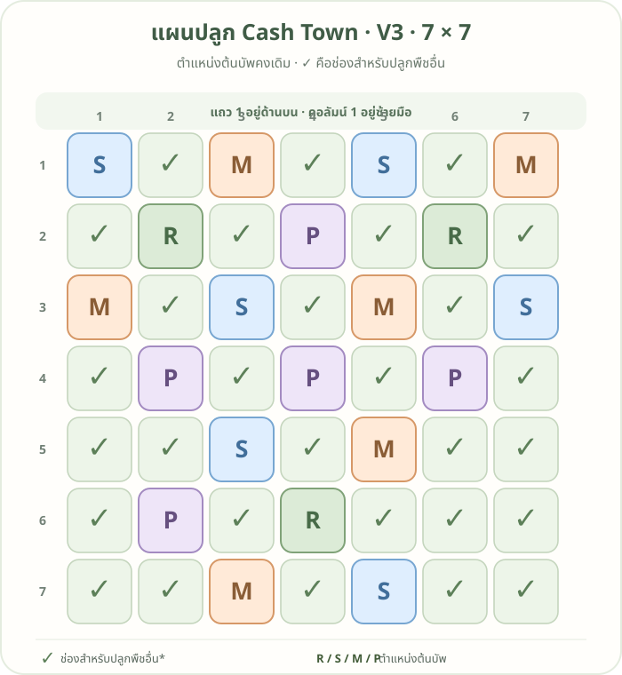

# แผนปลูก 7×7 · V3: ตำแหน่งต้นบัพ

หน้านี้แสดงเฉพาะตำแหน่งต้นบัพ โดยคงการวางต้นบัพจาก V2 ไว้ ช่องอื่นที่มีเครื่องหมาย **✓** เป็นช่องสำหรับปลูกพืชชนิดอื่น

## อ่านรหัสต้นบัพ

พิกัดเขียนเป็น **แถว, คอลัมน์** โดยนับจากมุมซ้ายบน เริ่มที่ 1

| รหัส | พืชบัพ | แถบที่ช่วย | ตำแหน่ง |
|---|---|---|---|
| R | ถั่วรันเนอร์ | ดิน | (2,2), (2,6), (6,4) |
| S | สตรอว์เบอร์รี่สวน | น้ำ | (1,1), (3,3), (1,5), (3,7), (5,3), (7,5) |
| M | ดาวเรือง | ป้องกัน | (1,3), (3,1), (1,7), (3,5), (5,5), (7,3) |
| P | โบราจ | เกสร | (2,4), (4,2), (4,4), (4,6), (6,2) |

**✓** หมายถึงช่องสำหรับปลูกพืชอื่น เลือกชนิดพืชโดยคำนึงถึงคู่ปลูกของพืชนั้นด้วย

[ดูแผน V2 · แสดงชนิดพืชและตำแหน่ง](https://oattokun.github.io/cashtown/plot-plan-tier-2-v2.html)
