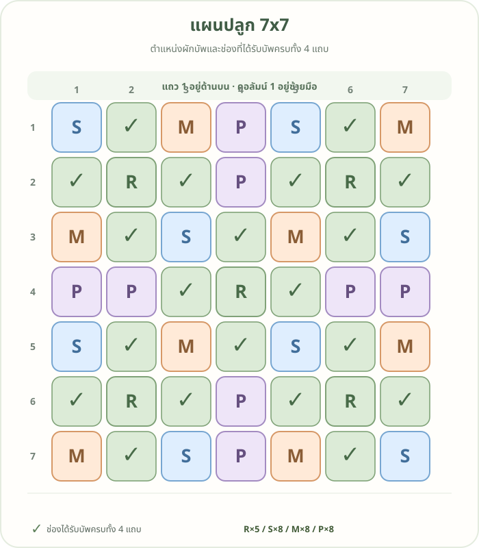
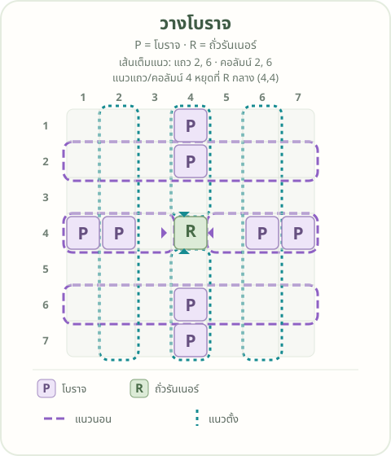

# แผนปลูก 7x7

<strong>⚠️ คำเตือน:</strong> ต้องปลูกผักบัพให้ครบก่อน แล้วค่อยปลูกผักหลัก หากปลูกผักหลักก่อน คุณภาพผักจะไม่เต็ม 100%

<a class="wiki-edit-button" href="https://github.com/oattokun/oattokun.github.io/edit/main/cashtown/plot-plan.md" target="_blank" rel="noopener">✏️ แก้ไขแผนบน GitHub</a>

เครื่องหมาย **✓** คือช่องที่ได้รับบัพครบทั้ง 4 แถบ

  
  

## อ่านรหัสต้นบัพ

พิกัดเขียนเป็น **แถว, คอลัมน์** โดยนับจากมุมซ้ายบน เริ่มที่ 1

| รหัส | พืชบัพ | แถบที่ช่วย | จำนวน | ตำแหน่ง |
|---|---|---|---:|---|
| R | ถั่วรันเนอร์ | ดิน | 5 | (2,2), (2,6), (4,4), (6,2), (6,6) |
| S | สตรอว์เบอร์รี่สวน | น้ำ | 8 | (1,1), (1,5), (3,3), (3,7), (5,1), (5,5), (7,3), (7,7) |
| M | ดาวเรือง | ป้องกัน | 8 | (1,3), (1,7), (3,1), (3,5), (5,3), (5,7), (7,1), (7,5) |
| P | โบราจ | เกสร | 8 | (1,4), (2,4), (4,1), (4,2), (4,6), (4,7), (6,4), (7,4) |

ในภาพโบราจ เส้นประสีม่วงแสดงแนวนอน (แถว 2, 4, 6) ส่วนเส้นประสีฟ้าอมเขียวแสดงแนวตั้ง (คอลัมน์ 2, 4, 6) แถว 2 และ 6 กับคอลัมน์ 2 และ 6 พาดเต็มแนว ส่วนแนวแถวและคอลัมน์ 4 หยุดที่ถั่วรันเนอร์ R ช่องกลาง (4,4)

รวมต้นบัพ **29 ช่อง** มีช่องปลูกที่ได้บัพครบ **20 ช่อง** และไม่มีช่องว่าง
