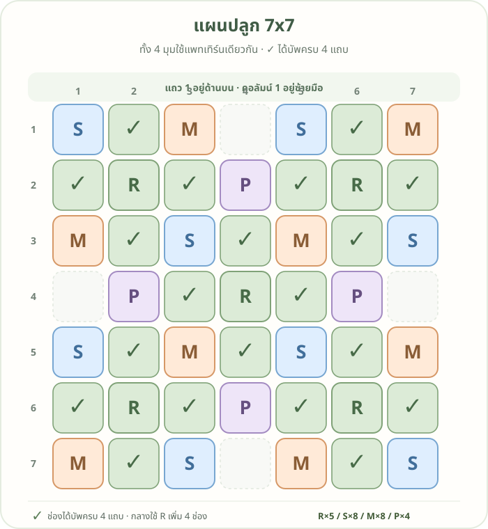

# แผนปลูก 7×7 · V4: mirror บน–ล่าง

<a class="wiki-edit-button" href="https://github.com/oattokun/oattokun.github.io/edit/main/cashtown/plot-plan-tier-2-v4.md" target="_blank" rel="noopener">✏️ แก้ไขแผนบน GitHub</a>

ผังนี้สะท้อนแถว **1–3** ลงมาเป็นแถว **7–5** และคงแถวกลางไว้ ตำแหน่งต้นบัพจึงสมมาตรบน–ล่าง เครื่องหมาย **✓** คือช่องที่ได้รับบัพครบทั้ง 4 แถบ

## อ่านรหัสต้นบัพ

พิกัดเขียนเป็น **แถว, คอลัมน์** โดยนับจากมุมซ้ายบน เริ่มที่ 1

| รหัส | พืชบัพ | แถบที่ช่วย | จำนวน | ตำแหน่ง |
|---|---|---|---:|---|
| R | ถั่วรันเนอร์ | ดิน | 4 | (2,2), (2,6), (6,2), (6,6) |
| S | สตรอว์เบอร์รี่สวน | น้ำ | 8 | (1,1), (1,5), (3,3), (3,7), (5,3), (5,7), (7,1), (7,5) |
| M | ดาวเรือง | ป้องกัน | 8 | (1,3), (1,7), (3,1), (3,5), (5,1), (5,5), (7,3), (7,7) |
| P | โบราจ | เกสร | 4 | (2,4), (4,2), (4,6), (6,4) |

โบราจตรงกลางที่ (4,4) ไม่จำเป็น เพราะช่อง ✓ ทั้งหมดได้เกสรจากโบราจที่แถว 2 หรือ 6 หรือจากแนวคอลัมน์ 2 หรือ 6 อยู่แล้ว

รวมต้นบัพ **24 ช่อง** มีช่องที่ได้บัพครบ **16 ช่อง** และช่องว่างอีก **9 ช่อง**
