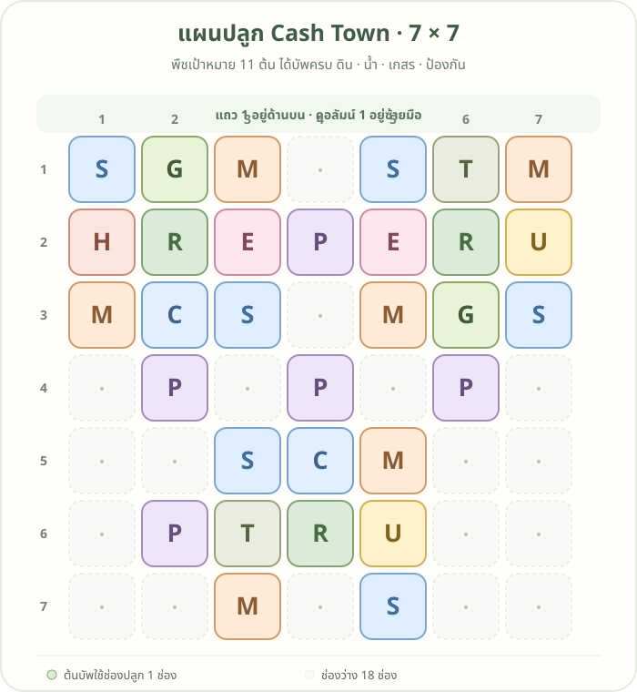

# แผนปลูก 7×7 · V1: 11 ต้น

นี่คือแผนเดิมที่จัดพืชเป้าหมาย **11 ต้น** ให้ได้แถบ **ดิน น้ำ เกสร และป้องกัน** ครบ

ดูแผนที่เพิ่มน้ำเต้าค้างอีก 1 ต้นได้ที่ [แผนปลูก V2](plot-plan-tier-2-v2.md)

## อ่านรหัสในผัง

| รหัส | พืช | จำนวน |
|---|---|---:|
| G | น้ำเต้าค้าง | 2 |
| E | เบอร์รี่ค้าง | 2 |
| C | ข้าวโพดสีน้ำเงิน | 2 |
| T | ยอดชาพุ่ม | 2 |
| U | ทานตะวันสวน | 2 |
| H | กระเจี๊ยบแดงสวน | 1 |
| R | ถั่วรันเนอร์ — บัพดิน | 3 |
| S | สตรอว์เบอร์รี่สวน — บัพน้ำ | 6 |
| M | ดาวเรือง — บัพป้องกัน | 6 |
| P | โบราจ — บัพเกสร | 5 |

## วิธีวางต้นบัพ

พิกัดเขียนเป็น **แถว, คอลัมน์** โดยนับจากมุมซ้ายบน เริ่มที่ 1

| บัพ | ตำแหน่ง | วิธีที่พืชเป้าหมายได้รับบัพ |
|---|---|---|
| ดิน · ถั่วรันเนอร์ | (2,2), (2,6), (6,4) | ปลูกพืชเป้าหมายติดด้านบน ล่าง ซ้าย หรือขวา |
| น้ำ · สตรอว์เบอร์รี่สวน | (1,1), (3,3), (1,5), (3,7), (5,3), (7,5) | ช่องข้างต้นสตรอว์เบอร์รี่ได้รับบัพ |
| ป้องกัน · ดาวเรือง | (1,3), (3,1), (1,7), (3,5), (5,5), (7,3) | วางพืชเป้าหมายในช่องรอบดาวเรือง |
| เกสร · โบราจ | (2,4), (4,2), (4,4), (4,6), (6,2) | จัดแนวโบราจให้อยู่แถวหรือคอลัมน์เดียวกับพืชเป้าหมาย |

ผังใช้ทั้งหมด **31 ช่อง**: พืชเป้าหมาย 11 ต้น และต้นบัพ 20 ต้น เหลือช่องว่าง 18 ช่อง หากเพิ่มพืชลงในช่องว่าง ควรตรวจว่าต้นใหม่นั้นได้รับบัพครบตามต้องการด้วย

> หมายเหตุ: ตามภาพสูตรคราฟต์ที่มี เบอร์รี่ค้าง ข้าวโพดสีน้ำเงิน และยอดชาพุ่มเป็น Tier 3 ส่วนชนิดอื่นในรายการเป็น Tier 2
